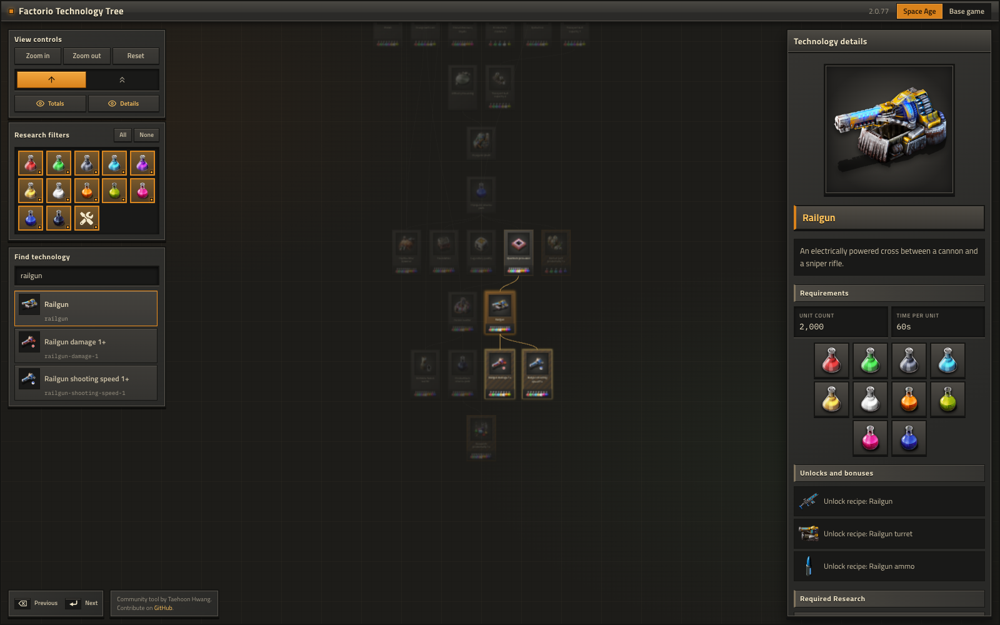

# Factorio Tech Tree

[Explore Factorio’s technology tree](https://factorio-tech-tree.com/) and plan your next research, in the base game or Space Age.

## Features

- Switch between base Factorio 2.x and Space Age.
- Search technologies and filter by science packs.
- Inspect research costs, prerequisites, unlocks, and bonuses.
- Highlight the full prerequisite tree and see total science pack requirements.
- Pan, zoom, and revisit selections with back and forward navigation.

## Contributing

Bug reports, suggestions, and pull requests are welcome. See the [contributing guidelines](CONTRIBUTING.md) to get started.

## License

Project code is licensed under the [MIT License](LICENSE). Factorio game data and graphics belong to Wube Software and are not covered by this license. This is an unofficial fan project.
